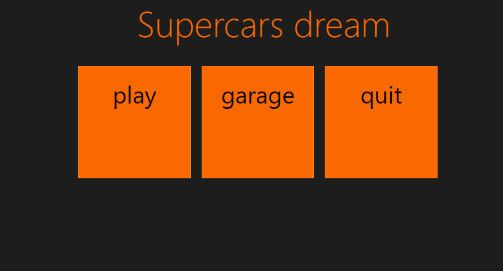

# Supercars dream game


A 3D racing game prototype developed with multiple web technologies and packaged as a mobile app with Apache Cordova.




---

Supercars Dream is a versatile racing game project featuring different implementations and technology stacks to experiment and optimize gameplay and rendering.

## Technologies

- Vue.js — frontend framework  
- PlayCanvas — 3D rendering engine (used in `playcanvas` branch)  
- Babylon.js — 3D rendering engine (used in `develop` branch)  
- Apache Cordova — mobile packaging for Android  
- JavaScript  

## Branches

This repository contains multiple branches reflecting different development efforts:

- `develop` — main development branch built with Babylon.js  
- `playcanvas` — version built using the PlayCanvas 3D engine  
- `vue` — frontend version developed with Vue.js framework  
- `temporary` — experimental branch for testing new features or ideas  

Each branch represents a different approach or technology stack for the Supercars Dream project, allowing flexible development and testing.

## Android Mobile Game

Supercars Dream is packaged as a mobile app using Apache Cordova, enabling deployment on Android devices.

### Getting Started

To build and run the game on an Android device:

1. Ensure you have Node.js and Cordova installed (`npm install -g cordova`)  
2. Clone the repo and navigate to the project folder  
3. Add Android platform:  
   ```bash
   cordova platform add android
   ```  
4. Build the app:  
   ```bash
   cordova build android
   ```  
5. Deploy and run on device or emulator:  
   ```bash
   cordova run android
   ```  

### Requirements

- Android 6.0 (API level 23) or higher recommended  
- Device with WebGL support for best performance  

## Project Status

This is an ongoing project with active development. Current focus is on refining physics and adding new tracks and vehicles.

## Future Plans

- Implement AI opponents and multiplayer mode  
- Enhance UI and audio effects  
- Expand the number of tracks and cars  

## See Also

- **gd-supercars-dream (Godot)** – Private project (Godot Engine version)  
- **xenko-supercars-dream (Stride)** – Private project (Stride/Xenko Engine version)  

*These related projects are currently private but showcase the multi-engine development of the Supercars Dream series.*

## License

